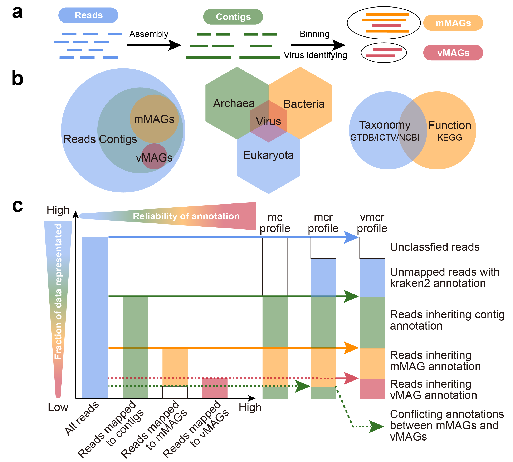
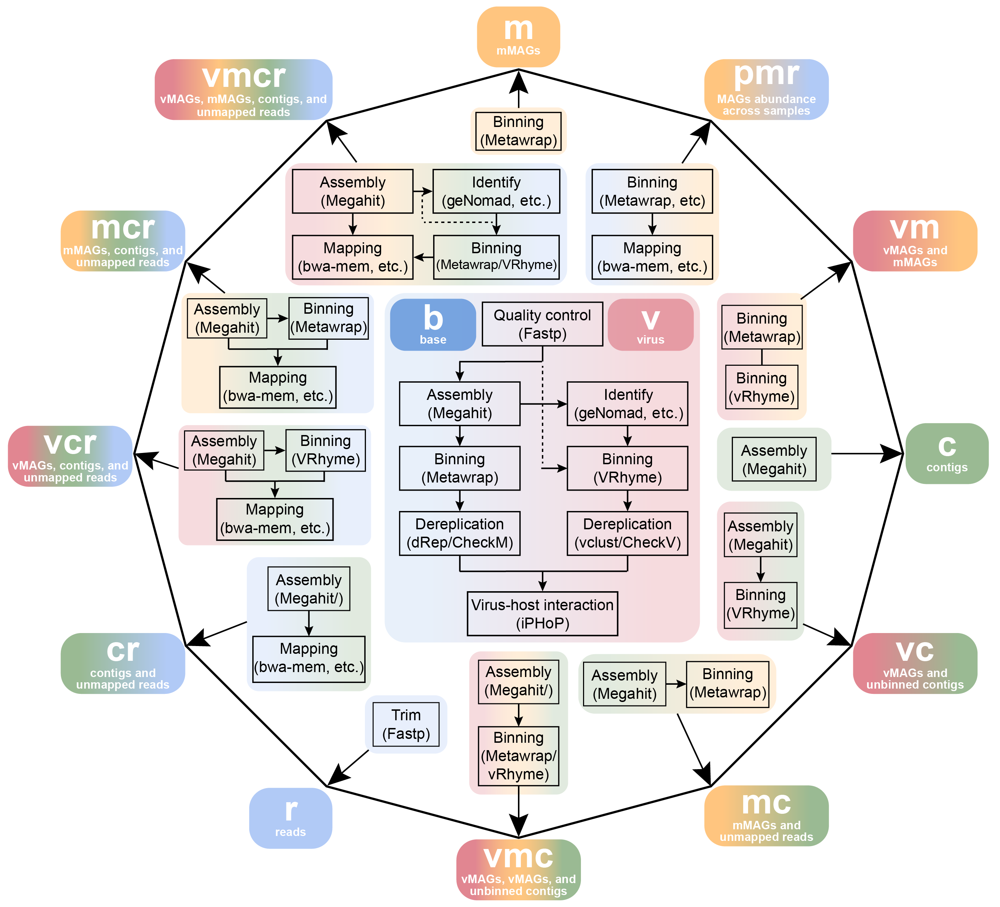
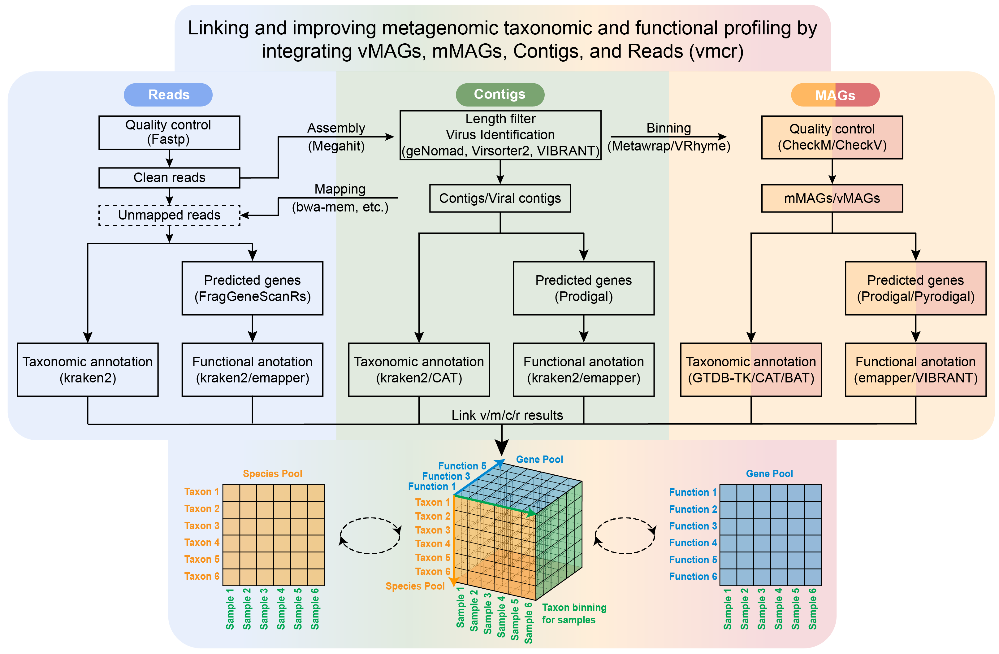
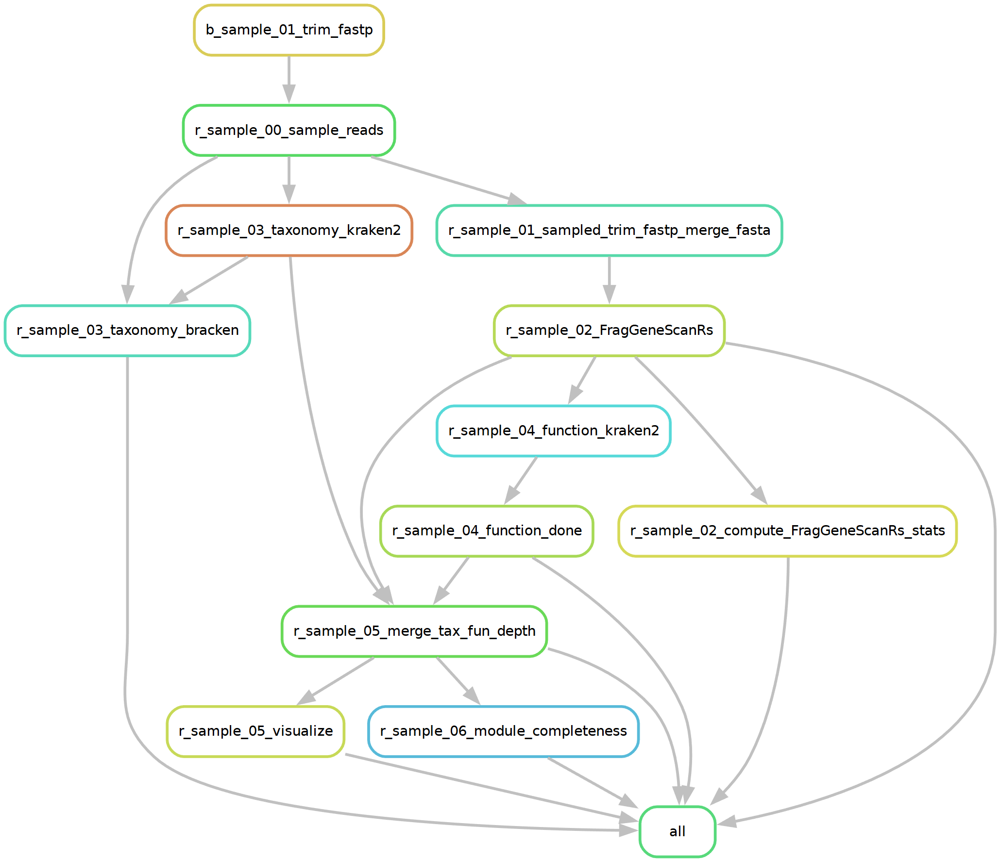

# Metalink

[](LICENSE)

> **Metalink**: Joint taxonomic and functional profiling of metagenomes and metatranscriptomes across resolution scales.

Metalink is a scalable, end-to-end metagenomic/metatranscriptomic analysis workflow built on [Snakemake](https://snakemake.github.io). It overcomes the fundamental limitation that existing tools profile taxonomy and function independently, and typically operate on only one analytical level (reads, contigs, or MAGs). Metalink couples taxonomic and functional profiling into joint outputs through three core innovations:

1. **LCFH (Last Common Function-based functional Hierarchy)**: Reorganizes ~424 million KO annotations into a seven-level tree-structured functional classification, enabling k-mer-based classifiers (e.g., kraken2) to perform functional assignment with LCA-like resolution.
2. **Unified Taxonomic Framework**: Integrates GTDB (prokaryotes), ICTV (viruses), and NCBI (microeukaryotes) into a single, version-traceable taxonomy, ensuring consistent classification across reads, contigs, and MAGs.
3. **Multi-Level Integration**: Combines MAG, contig, and read-level analyses with overlap-based deduplication, balancing the accuracy of assembly-based methods with the completeness of read-level profiling.

<p align="center">
  
</p>

<p align="center">
  <em>Fig. 1 | Metalink's strategy: reads, contigs, mMAGs and vMAGs assembled/binned from metagenomes (a), jointly annotated with a unified taxonomy and function framework (b), and integrated into multi-level profiles with increasing annotation reliability (c).</em>
</p>

---

## Table of contents

- [Features](#features)
- [Installation & Setup](#installation--setup)
  - [Metalink CLI Installation](#metalink-cli-installation)
    - [PyPI (recommended for quick start)](#option-1-pypi-recommended-for-quick-start)
    - [Manual installation (from source)](#option-2-manual-installation-from-source)
    - [Bioconda installation](#option-3-bioconda-installation)
    - [Verify installation](#verify-installation)
  - [Workflow Environment Setup](#workflow-environment-setup)
    - [Minimal setup (read-only mode)](#minimal-setup-read-only-mode-r)
    - [Full setup (all analysis modes)](#full-setup-all-analysis-modes)
  - [Database setup](#database-setup)
    - [Quick setup](#quick-setup)
    - [Database directory structure](#database-directory-structure)
- [Quick start](#quick-start)
  - [Prepare input](#prepare-input)
  - [Run analysis](#run-analysis)
  - [Minimal database setup (read mode only)](#minimal-database-setup-read-mode-only)
  - [Reusing a config file](#reusing-a-config-file)
- [Running modes](#running-modes)
  - [Available modes](#available-modes)
  - [Skip-level modes](#skip-level-modes)
    - [Advanced skip-level use cases](#advanced-skip-level-use-cases)
  - [Paired-end vs single-end vs long-read](#paired-end-vs-single-end-vs-long-read)
  - [Metatranscriptomes](#metatranscriptomes)
  - [Long reads (Nanopore / PacBio)](#long-reads-nanopore--pacbio)
- [Resume an interrupted run](#resume-an-interrupted-run)
- [Documentation](#documentation)
- [Citation](#citation)
- [License](#license)
- [Support](#support)

---

## Features

1. **Comprehensive & Scalable Workflow**:  14 analysis modes (b to vmcr) covering assembly, binning, taxonomy, function, and metabolic pathway completeness. Supports 2nd-generation short reads (single-end / paired-end), 3rd-generation long reads (PacBio / Nanopore), and metatranscriptomes (read and assembly-level profiling). Built on Snakemake with robust dependency tracking, dry-run (`-n`), resume (`--ri`/`--rerun-incomplete`), and cluster execution.
2. **Accurate Taxonomic & Functional Profiling**: Fast k-mer-based classification (kraken2) with a unified taxonomy integrating GTDB (prokaryotes), ICTV (viruses), and NCBI (microeukaryotes). The LCFH (Last Common Function-based functional Hierarchy) reorganizes ~424 million KO annotations into a seven-level tree (lv1–lv7), enabling LCA-like functional assignment.
3. **Joint Taxonomic-Functional Output**: Per-sequence co-annotation directly answers which species contribute to which functions, transforming analysis from cataloging species and functions to mechanistic inference of species–function–environment triadic associations.

---

## Installation & Setup

Setting up Metalink involves three steps: installing the Metalink CLI, creating the workflow tool environments, and downloading the databases.

### Metalink CLI Installation

Metalink can be installed via three methods. Choose the one that best fits your workflow.

#### Option 1: PyPI (recommended for quick start)

The fastest way to get the Metalink CLI:

```bash
# 1. Create a Python environment
conda create -n metalink-0.3.7
conda activate metalink-0.3.7
mamba install -c conda-forge -c bioconda python=3.11 snakemake=7.32.4 click ruamel.yaml graphviz

# 2. Install Metalink from PyPI
pip install metalink
```

> [!NOTE]
> PyPI provides only the Metalink CLI and core Python dependencies (`snakemake`, `click`, `ruamel.yaml`).
> The workflow-specific tool environments (e.g., `metalink-main-0.3` with `kraken2`, `mclink`, etc.) must be created separately.
> See [Workflow Environment Setup](#workflow-environment-setup) below.

#### Option 2: Manual Installation (from source)

For developers or users who want the latest development version.

Metalink is compatible with a range of Snakemake versions. Tested combinations:

  | Snakemake | Python |
  |-----------|--------|
  | 7.32.4 | 3.11 |
  | 8.24.1 | 3.12 |
  | 9.25.2 | 3.14 |

```bash
# 1. Clone the repository
git clone https://github.com/LiuyangLee/Metalink.git
cd Metalink

# 2. Create a Python environment for the Metalink CLI
conda create -n metalink-0.3.7
conda activate metalink-0.3.7
mamba install -c conda-forge -c bioconda python=3.11 snakemake=7.32.4 click ruamel.yaml graphviz

# 3. Install Metalink CLI
pip install -e .
```

#### Option 3: Bioconda Installation

```bash
conda create -n metalink-0.3.7
conda activate metalink-0.3.7
mamba install -c bioconda metalink
```

> [!NOTE]
> Bioconda availability is pending approval. Until then, use Option 1 or 2.


#### Verify installation

```bash
conda activate metalink-0.3.7
metalink --help
metalink b --help
```

---

### Workflow Environment Setup

Metalink relies on Snakemake to orchestrate multiple third-party tools. These tools are organized into **separate conda environments** to avoid dependency conflicts. After installing the Metalink CLI (via any method above), you must create the workflow environments before running analyses.

The environment YAML files are bundled inside the installed `metalink` package. Export them once with the built-in `get-envs` command (this works for all three installation methods; with a source checkout the same files also live at `metalink/envs/`):

```bash
metalink get-envs -o ./metalink_envs
```

(`metalink get-envs` without `-o` just prints the bundled envs directory path, e.g. for `mamba env create -f "$(metalink get-envs)/metalink-main.yaml"`.)

#### Minimal setup (read-only mode `r`)

For read-level profiling only, only `metalink-main-0.3` is required:

```bash
mamba env create -f ./metalink_envs/metalink-main.yaml
```

This covers the default `r` configuration (`reads_function_classify_method = kraken2`). If you set `reads_function_classify_method = emapper`, the `metalink-annotation-0.3` environment is additionally required.

> [!IMPORTANT]
> Bioconda availability of `r-mclink` is pending approval (20260825). Until the package is accepted into the Bioconda channel, install it manually after creating the environment:
> ```bash
> conda activate metalink-main-0.3
> R
> install.packages("mclink")
> ```


#### Full setup (all analysis modes)

For assembly, binning, MAG-level, and virus-level analysis, create all environments:

```bash
# Base read-mode environment (required for all modes)
mamba env create -f ./metalink_envs/metalink-main.yaml

# Assembly & binning
mamba env create -f ./metalink_envs/metalink-binning.yaml

# MAG quality & taxonomy
mamba env create -f ./metalink_envs/metalink-gtdbtk.yaml
mamba env create -f ./metalink_envs/metalink-checkm2.yaml
mamba env create -f ./metalink_envs/metalink-annotation.yaml

# Viral analysis
mamba env create -f ./metalink_envs/metalink-genomad.yaml
mamba env create -f ./metalink_envs/metalink-vclust.yaml
mamba env create -f ./metalink_envs/metalink-vibrant.yaml
mamba env create -f ./metalink_envs/metalink-virsorter.yaml
mamba env create -f ./metalink_envs/metalink-vrhyme.yaml
mamba env create -f ./metalink_envs/metalink-iphop.yaml
```

> [!IMPORTANT]
> Keep the environment **names** exactly as defined in the YAML files (e.g. `metalink-main-0.3`, `metalink-gtdbtk-2.4.1`, ...). These names are referenced by the workflow rules and scripts via the `conda_envs` mapping in the config. If you use custom names, you must manually edit the generated **config.\<mode\>.yaml** file (under `out_dir/config/`) to update each tool's entry under the `conda_envs` section.


### Database setup

#### Quick setup

Download all databases (Metalink-built + third-party):

```bash
# -n for dry run, -p is passed through to Snakemake (--printshellcmds, print shell commands)
metalink download-database -d db_dir -pn
```

Or download only selected databases by listing comma-separated names:

```bash
metalink download-database -d db_dir --databases kraken2_taxonomy,kraken2_function,cat_pack_db
```

The Metalink kraken2 databases come in size variants; default is `kraken2_raw`:

```bash
metalink download-database -d db_dir --databases kraken2_taxonomy --kraken2-taxonomy-db-size kraken2_16GB
```

Available sizes: taxonomy `kraken2_16GB` / `kraken2_64GB` / `kraken2_256GB` / `kraken2_raw`; function `kraken2_16GB` / `kraken2_raw`.

Approximate disk and memory requirements of the databases (Metalink-built: v20250930; third-party: versions as shipped by `metalink download-database`):

| Database | Variant | Disk space | kraken2 RAM |
|----------|---------|-----------|-------------|
| kraken2 + bracken taxonomy DB | `kraken2_16GB` | ~35 GB | ~15 GB |
| kraken2 + bracken taxonomy DB | `kraken2_64GB` | ~79 GB | ~60 GB |
| kraken2 + bracken taxonomy DB | `kraken2_256GB` | ~256 GB | ~240 GB |
| kraken2 + bracken taxonomy DB | `kraken2_raw` (default) | ~652 GB | ~640 GB |
| kraken2 function DB (LCFH) | `kraken2_16GB` | ~29 GB | ~15 GB |
| kraken2 function DB (LCFH) | `kraken2_raw` (default) | ~74 GB | ~60 GB |
| CAT_pack DB | — | ~198 GB | — |
| eggNOG-mapper DB | v5.0.2 | ~59 GB | — |
| GTDB-Tk DB | R226 | ~139 GB | — |
| CheckM2 DB | v1.1.0 | ~2.9 GB | — |
| CheckM DB | 2015_01_16 | ~1.4 GB | — |
| CheckV DB | v1.5 | ~6.4 GB | — |
| geNomad DB | v1.9 | ~1.4 GB | — |
| VirSorter2 DB | v2.2.4 | ~12 GB | — |
| VIBRANT DB | v1.2.1 | ~8.0 GB | — |
| iPHoP DB | Jun_2025_pub_rw | ~294 GB | — |

#### Database directory structure

During and after `metalink download-database`, the following directories are created under **DBDIR**:

```text
DBDIR/
├── kraken2_taxonomy_db/          # Metalink kraken2 taxonomy DB
│   └── v20250930/                # Build version
│       ├── kraken2_raw/          # Default
│       ├── kraken2_16GB/         # Optional
│       ├── kraken2_64GB/         # Optional
│       └── kraken2_256GB/        # Optional
├── kraken2_function_db/          # Metalink kraken2 function DB (LCFH)
│   └── v20250930/                # Build version
│       ├── kraken2_raw/          # Default
│       └── kraken2_16GB/         # Optional
├── cat_pack_db/                  # Metalink-customized CAT DB
│   └── v20250930/                # Build version
│       ├── cat_pack_gtdb_ncbi_ictv/
│       └── cat_pack_ictv/
├── eggnog_db/                    # eggNOG-mapper data
│   └── v5.0.2/
│       ├── eggnog_proteins.dmnd
│       └── mmseqs/
├── gtdbtk_db/                    # GTDB-Tk reference data
│   └── R226/
├── checkm2_db/                   # CheckM2 database
│   └── v1.1.0/
│       └── uniref100.KO.1.dmnd
├── checkm_db/                    # CheckM database (used by MetaWRAP binning)
│   └── checkm_data_2015_01_16/
├── checkv_db/                    # CheckV database
│   └── checkv-db-v1.5/
├── genomad_db/                   # geNomad database
│   └── genomad_db_v1.9/
├── virsorter2_db/                # VirSorter2 database
│   └── v2.2.4/
├── vibrant_db/                   # VIBRANT database
│   └── v1.2.1/
│       ├── databases/
│       └── files/
├── iphop_db/                     # iPHoP database
│   └── Jun_2025_pub_rw/
├── downloads/                    # Temporary download archives
├── logs/                         # Download and setup logs
├── markers/                      # Completion flags
├── config/                       # config.download.yaml used for the run
└── .metalink_db_bundle.yaml      # Installed bundle version
```

---

## Quick start

### Prepare input

Create a TSV file (`sample.tsv`) with the following columns:

**Paired-end reads**:

| sample | read_1 | read_2 |
|--------|--------|--------|
| sample1 | /path/to/sample1_r1.fastq.gz | /path/to/sample1_r2.fastq.gz |
| sample2 | /path/to/sample2_R1.fastq.gz | /path/to/sample2_R2.fastq.gz |
| sample3 | /path/to/sample3_read1.fq.gz | /path/to/sample3_read2.fq.gz |

**Single-end reads**:

| sample | read_s |
|--------|--------|
| sample1 | /path/to/sample1.fastq.gz |
| sample2 | /path/to/sample2.fastq.gz |

**With pre-computed contigs or MAGs** (for skip-level ≥ 2):

| sample | read_1 | read_2 | contig_file | mMAG_dir |
|--------|--------|--------|-------------|----------|
| sample1 | /path/to/sample1_r1.fastq.gz | /path/to/sample1_r2.fastq.gz | /path/to/sample1.contigs.fa | /path/to/sample1_mags_dir/ |
| sample2 | /path/to/sample2_r1.fastq.gz | /path/to/sample2_r2.fastq.gz | /path/to/sample2.contigs.fa | /path/to/sample2_mags_dir/ |

> [!IMPORTANT]
>- Supports `.fastq.gz` and `.fq.gz` extensions.
>- The input TSV is validated when the workflow starts: it must be tab-separated, contain a `sample` column plus the columns required by your read type and skip-level (`read_1`/`read_2` for paired, `read_s` for single-end/long reads, `contig_file` for skip-level ≥ 2, `mMAG_dir` for skip-level ≥ 3), and required columns must not be empty.
>- All FASTA files (contigs, MAGs) must **not** contain `---` in headers (used as internal delimiter).
>- MAG directories should contain `.fa` files.
>- The contig IDs must match between MAG files and the contigs file.

### Run analysis

**Option 1: Dry run (preview execution plan, highly recommended)**

```bash
metalink r -i sample.tsv -d db_dir -w out_dir --verbose -p -n
```

**Option 2: Run locally with 40 threads**

```bash
metalink r -i sample.tsv -d db_dir -w out_dir --verbose -p -j 40 --ri -k
```
Snakemake flags: `--ri`/`--rerun-incomplete` (re-run incomplete jobs), `-k`/`--keep-going` (continue execution if one job fails).

**Option 3: Run with specified parameters**

```bash
metalink r -i sample.tsv -d db_dir -w out_dir --reads-taxonomy-kraken2-confidence 0.1 -p -j 40
```

> [!NOTE]
> Default values differ by mode (`--reads-taxonomy-kraken2-confidence`: 0.6; `--contigs-taxonomy-kraken2-confidence` and `--*cr-taxonomy-kraken2-confidence` thresholds: 0.7). For higher-complexity samples (or simplified database), a lower threshold is usually recommended to retain sensitivity. See [FAQ: How do I choose the kraken2 confidence threshold for taxonomic classification?](README.md#q-how-do-i-choose-the-kraken2-confidence-threshold-for-taxonomic-classification) and Wright et al. (2023) for detailed guidance.

**Option 4: Run with project-level analysis**

```bash
metalink r -i sample.tsv -d db_dir -w out_dir --run-project -p -j 40
```

| | Without `--run-project` | With `--run-project` |
|---|---|---|
| **Scope** | Sample-level analysis only | **Both** sample-level **and** project-level analysis |
| **What it does** | Processes each sample independently through the full pipeline | **Automatically runs all sample-level steps first**, then executes project-level rules that aggregate results across all samples |
| **Extra outputs** | Per-sample results only | Additional merged tables, cross-sample statistics, project-wide dereplication (e.g., dRep), and comparative visualizations |
| **When to use** | Only need individual sample reports | Full project analysis requiring cross-sample comparison and summary |

> [!IMPORTANT]
> `--run-project` does **not** skip or replace sample-level analysis. Snakemake will first build and execute the sample-level targets for every entry in your sample sheet, and only after those complete will it trigger the project-level aggregation rules. Think of it as "run everything, then also generate the project summary."

> [!TIP]
> **Quoting tool-specific `extra_args`**: When forwarding extra arguments to third-party tools (e.g., `--spades-extra-args`, `--metaflye-extra-args`, `--binning-metawrap-extra-args`), wrap the value in quotes even if it contains a single flag or multiple flags/values:
> ```bash
> --metaflye-extra-args "--iterations 2"
> --binning-metawrap-extra-args "-m 5"
> ```


### Minimal database setup (read mode only)

If you only need read-level profiling, you can run Metalink with a subset of the databases by limiting the read-mode endpoint. The `--target-stage` parameter controls which stages are executed: `"taxonomy"`, `"function"`, `"taxonomy_and_function"`, or `"all"`. When you choose `"taxonomy"` or `"function"`, only the corresponding kraken2 database and lineage file need to be present.

#### 1. Taxonomy-only profiling

Required kraken2-format databases:
- `kraken2_taxonomy_db/v20250930/kraken2_raw/` → set as `Directory.database.kraken2_taxonomy_db`

Example command:

```bash
metalink r -i sample.tsv -d db_dir -w out_dir -j 40 --target-stage taxonomy
```

With this setup, Metalink will run trimming, and kraken2 taxonomy classification, then stop before the function-classification and joint-analysis steps.

#### 2. Function-only profiling

Required Metalink-built databases:
- `kraken2_function_db/v20250930/kraken2_raw/` → set as `Directory.database.kraken2_function_db`

Example command:

```bash
metalink r -i sample.tsv -d db_dir -w out_dir -j 40 --target-stage function
```

With this setup, Metalink will run trimming, gene prediction, and kraken2 function classification (LCFH), then stop before the taxonomy classification and joint-analysis steps.

> [!IMPORTANT]
>- The third-party databases (GTDB-Tk, CheckM2, eggNOG, virus tools, etc.) are **not** required for read-only taxonomy or function profiling when the endpoint is set as shown above.

---

### Reusing a config file

Metalink supports generating and reusing configuration files to ensure reproducibility and allow parameter tuning without retyping all CLI options.

**Step 1: Generate config only (without running)**

```bash
metalink c -i sample.tsv -d db_dir -w out_dir --generate-config
```
This will generate a config file: out_dir/config/config.c.yaml

**Step 2: Re-execute from the generated config (supports manual editing)**

Copy and (optionally) edit the config, then re-execute from it:
```bash
cp out_dir/config/config.c.yaml out_dir/config/config.c.manually.yaml
metalink c -c out_dir/config/config.c.manually.yaml -p -n
```


**Step 3: Re-execute from the generated config (supports overriding via command line)**
You can also override individual tool parameters without editing the config:

```bash
metalink c -c out_dir/config/config.c.yaml -p -n --depth-min-contig-length 1000
```

In this case Metalink creates a temporary config.c.runtime.*.yaml with the merged values and passes it to Snakemake.

---

## Running modes

### Available modes

<p align="center">
  
</p>

<p align="center">
  <em>Fig. 2 | Relationship between Metalink modes: the base (<code>b</code>) and virus (<code>v</code>) chains feed all higher-level modes.</em>
</p>

| Mode | Levels Included | Description |
|------|-------------|-----------------|
| `b` | base | trim, assembly, binning, checkm |
| `r` | reads | reads taxonomy and function annotations |
| `c` | contigs | contigs taxonomy and function annotations |
| `cr` | contigs + unmapped reads | c + r integration |
| `m` | mMAGs | mMAGs quality, taxonomy, function, drep |
| `mc` | mMAGs + contigs | m + c integration |
| `mcr` | mMAGs + contigs + unmapped reads | m + c + r integration |
| `pmr` | MAGs + reads | project-level MAGs + read analysis; `--mags m\|v\|vm` selects the MAG source (mMAGs / vMAGs / mMAGs+vMAGs combined into one reference with a single mapping pass) |
| `v` | vMAGs | viral identification, clustering, host prediction |
| `vc` | vMAGs + contigs | v + c integration |
| `vcr` | vMAGs + contigs + unmapped reads | v + c + r integration |
| `vm` | vMAGs + mMAGs |  v + m integration |
| `vmc` | vMAGs + mMAGs + contigs | vm + c integration |
| `vmcr` | vMAGs + mMAGs + contigs + unmapped reads | v + m + c + r integration |

<p align="center">
  
</p>

<p align="center">
  <em>Fig. 3 | The fully integrated vmcr workflow: reads, contigs, mMAGs and vMAGs are annotated for taxonomy and function, and linked into unified per-sample species and gene pools.</em>
</p>

**Visualize the difference with DAG graphs:**

You can compare the two execution plans directly by generating rule graphs:

```bash
# r sample-level only DAG
metalink r -i sample.tsv -w out_dir --rulegraph | dot -Tpdf > Metalink.r.sample.dag.pdf

# vmcr sample-level + project-level DAG
metalink vmcr -i sample.tsv -w out_dir --run-project --rulegraph | dot -Tpdf > Metalink.vmcr.project.dag.pdf
```

<p align="center">
  
</p>

<p align="center">
  <em>Fig. 4 | Rule graph of the <code>r</code> mode, generated directly with <code>metalink r -i sample.tsv -w out_dir --rulegraph | dot -Tpdf &gt; Metalink.r.sample.dag.pdf</code>: each node is a Snakemake rule and each edge is a file dependency between rules.</em>
</p>


### Skip-level modes

Use `--skip-level` (0–3) to skip upstream steps if you already have pre-computed results:

| Skip-level | Skips | Required Inputs | Use Case |
|------------|-------|-----------------|----------|
| `0` (default) | Nothing | Raw FASTQ / FASTQ.GZ | Start from scratch (any read type) |
| `1` | Trimming (`fastp` / `fastplong`) | Clean FASTQ / FASTQ.GZ | Pre-trimmed reads available |
| `2` | Trimming + Assembly (`megahit` / `SPAdes` / `metaflye`) | Clean FASTQ + Contigs | Pre-assembled contigs available |
| `3` | Trimming + Assembly + Binning | Clean FASTQ + Contigs + mMAGs | Pre-binned mMAGs available |

> [!NOTE]
> The trimming tool and assembler are selected and validated automatically based on `--read-type`.

#### Advanced skip-level use cases

Metalink's built-in assembler and binner combinations cover the most common scenarios (MEGAHIT, SPAdes, metaFlye; MetaBAT2, MaxBin2, CONCOCT). For workflows that require tools or parameters not directly exposed by Metalink, use `--skip-level` to input externally generated results and continue with Metalink's downstream taxonomy, function, and integration analyses.

| Use case | Skip-level | What you provide | Metalink mode | What Metalink does |
|----------|-----------|------------------|---------------|-------------------|
| **Hybrid assembly** (2nd-gen + 3rd-gen mixed) | `2` | Pre-assembled contigs (from external hybrid assembler) + clean reads (paired or long reads) | Any (`c`, `m`, `mc`, `mcr`, etc.) | Skips trimming and assembly; runs mapping, binning, annotation, and MAGs/contigs/reads taxonomy/function annotation and project-level aggregation |
| **Long-read binning** | `3` | Pre-binned MAGs (from external binner) + contigs (from external assembler) + clean reads | Any (`m`, `mc`, `mcr`, etc.) | Skips trimming, assembly, and binning; runs MAGs/contigs/reads taxonomy/function annotation and project-level aggregation |
| **Metatranscriptome read mapping to MAGs** | `3` | Pre-binned MAGs (from external binner) + metatranscriptome reads | `pmr` | Skips trimming, assembly, and binning; maps reads to provided MAGs and performs project-level MAG + read analysis |

> [!TIP]
>- For hybrid assembly, generate contigs with your preferred tool, then supply them in the TSV's `contig_file` column and run with `--skip-level 2`.
>- For metatranscriptomes, rRNA should be removed.
>- For `--skip-level 3`, place each sample's MAG directory (with existing MAGs) in the `mMAG_dir` column of the TSV.
>- For `v`/`vc`/`vcr` and `pmr --mags v`, skip-level `3` is equivalent to skip-level `2` (these modes do not use mMAGs, so the `mMAG_dir` column is not required).


**Examples**:

```bash
# Skip-level 0: Start from raw reads (default)
metalink mcr -i sample.tsv -d db_dir -w out_dir -j 4

# Skip-level 1: Start from clean reads (skip fastp / fastplong trimming)
# Provide clean FASTQ paths
metalink mcr -i sample.tsv -d db_dir -w out_dir --skip-level 1 -j 4

# Skip-level 2: Start from contigs + clean reads (skip MEGAHIT assembly)
# TSV must contain a contig_file column with contig paths
metalink mcr -i sample.tsv -d db_dir -w out_dir --skip-level 2 -j 4

# Skip-level 3: Start from MAGs + contigs + clean reads (skip binning)
# TSV must contain a mMAG_dir column with MAG directory paths
metalink mcr -i sample.tsv -d db_dir -w out_dir --skip-level 3 -j 4
```

### Paired-end vs single-end vs long-read

Metalink uses `--read-type` to select between paired-end, single-end, and long-read rule sets. The choice of `--read-type` determines the trimming tools and assembly softwares.

| `--read-type` | Trimming | Assembly (default) | Use case |
|---------------|----------|-------------------|----------|
| `paired` (default) | `fastp` | `megahit` or `spades` (`--meta` for metaSPAdes) | Illumina paired-end |
| `single` | `fastp` | `megahit` | Illumina single-end |
| `paired-rna` | `fastp` | `spades` (`"--rna"` for rnaSPAdes) | Paired-end RNA short reads |
| `single-rna` | `fastp` | `spades` (`"--rna"` for rnaSPAdes) | Single-end RNA short reads |
| `pacbio-raw` | `fastplong` | `metaflye` | PacBio CLR raw |
| `pacbio-corr` | `fastplong` | `metaflye` | PacBio corrected CLR |
| `pacbio-hifi` | `fastplong` | `metaflye` | PacBio HiFi |
| `nano-raw` | `fastplong` | `metaflye` | ONT raw |
| `nano-corr` | `fastplong` | `metaflye` | ONT corrected |
| `nano-hq` | `fastplong` | `metaflye` | ONT high-quality |

**Paired-end short reads** (default, `--read-type paired`):

```bash
metalink c -i sample.tsv -d db_dir -w out_dir --read-type paired -j 4
```

**Single-end short reads** (`--read-type single`):

```bash
metalink c -i sample.tsv -d db_dir -w out_dir --read-type single -j 4
```

**Long reads** (`--read-type pacbio-hifi`, `nano-hq`, etc.):

```bash
metalink c -i sample.tsv -d db_dir -w out_dir --read-type pacbio-hifi -j 4
```

### Metatranscriptomes

Metalink supports metatranscriptomic analysis via the `c`, `cr`, `r`, `v`, `vc`, and `vcr` modes. **rRNA and other non-coding RNA sequences must be removed prior to input** (e.g., with [RiboDetector](https://github.com/hzi-bifo/RiboDetector)). Metalink assumes the input reads are already protein-coding-enriched.

```bash
# Paired-end metatranscriptome (provide rRNA-depleted reads)
metalink r -i mt_samples_rrnaremoved.tsv -d db_dir -w out_dir --read-type paired-rna -j 4

# Single-end metatranscriptome (provide rRNA-depleted reads)
metalink r -i mt_samples_rrnaremoved.tsv -d db_dir -w out_dir --read-type single-rna -j 4
```

> [!IMPORTANT]
> Metalink does not include a metatranscriptome binner. For MAG-level analysis, you can run `metalink pmr --skip-level 3` with pre-binned MAGs (e.g., metagenomic bins with metatranscriptomic reads).
>
> When analyzing metatranscriptomes with a virus mode, the `vs_vb`/`genomad_vs_vb` virus identification method runs VirSorter2 with the `--include-groups dsDNAphage,NCLDV,RNA,ssDNA,lavidaviridae` parameter.

### Long reads (Nanopore / PacBio)

#### Supported read types

| `--read-type` | Platform | Description |
|---------------|----------|-------------|
| `pacbio-raw` | PacBio | Raw continuous long reads (CLR) |
| `pacbio-corr` | PacBio | Corrected CLR reads |
| `pacbio-hifi` | PacBio | High-fidelity reads |
| `nano-raw` | Oxford Nanopore | Raw basecalled reads |
| `nano-corr` | Oxford Nanopore | Corrected reads |
| `nano-hq` | Oxford Nanopore | High-quality (Q20+) reads |

For assembly-based modes, Metalink automatically selects the appropriate tools based on `--read-type`:

- **Trimming**: `fastplong` is used for all long-read types (instead of `fastp`).
- **Assembly**: `metaFlye` is automatically selected (instead of `MEGAHIT` / `SPAdes`).

```bash
# PacBio HiFi assembly + contig analysis
metalink c -i pacbio_sample.tsv -d db_dir -w out_dir --read-type pacbio-hifi -j 4 --run-project
```

> [!IMPORTANT]
> Each long-read `read-type` maps to the corresponding Flye mode:
>  - `pacbio-raw` → `--pacbio-raw`
>  - `pacbio-corr` → `--pacbio-corr`
>  - `pacbio-hifi` → `--pacbio-hifi`
>  - `nano-raw` → `--nano-raw`
>  - `nano-corr` → `--nano-corr`
>  - `nano-hq` → `--nano-hq`

---


## Resume an interrupted run

Because Metalink is a Snakemake workflow, interrupted runs can be safely resumed without losing progress:

```bash
# Re-run the same command; Snakemake will skip completed steps
metalink r -i sample.tsv -d db_dir -w out_dir -j 20

# Force re-run incomplete jobs only
metalink r -i sample.tsv -d db_dir -w out_dir -j 20 --ri
```

Snakemake tracks completion via output file timestamps. If a job was interrupted (partial BAM, incomplete log), simply re-run the same command and Snakemake will detect and re-execute only the affected rules.

> [!WARNING]
> **Unlock before resuming an interrupted run**: If a previous run was killed abruptly (e.g., `Ctrl+C`, cluster preemption, or system crash), Snakemake may leave a lock file in `.snakemake/locks/`, causing subsequent runs to fail with an error such as `Error: Directory cannot be locked`. In this case, unlock the directory before resuming:
>
> ```bash
> metalink r -i sample.tsv -d db_dir -w out_dir --unlock
> ```
>
> After unlocking, re-run your original command normally. This is a Snakemake-specific operation and is often required when resuming workflows on shared file systems or HPC clusters.

---

## Documentation

| Resource | Link |
|----------|------|
| **Full Documentation** | [README.md](README.md) |
| **Snakemake Docs** | [https://snakemake.readthedocs.io](https://snakemake.readthedocs.io) |

---

## Citation

If you use Metalink in your research, please cite:

> Li et al. (202X). Metalink: Joint taxonomic and functional profiling of metagenomes and metatranscriptomes across resolution scales. *(under review)*.

Additionally, please cite the underlying tools and databases used in your analysis. See [README.md](README.md) for the complete list of software references.

## License

Metalink is released under the GNU General Public License v3.0 (GPL-3.0). See [LICENSE](LICENSE) for details.
